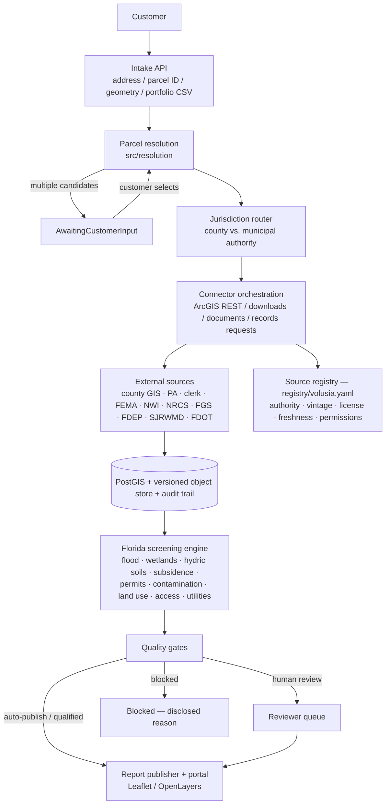

# GIS Property Intelligence Platform

Automated, drone-free property due-diligence and land-intelligence service. The platform resolves a
property (address, parcel ID, or geometry), discovers the authoritative public and licensed datasets
for its jurisdiction, fuses them, applies configurable analysis profiles, and publishes a traceable
screening report — with explicit provenance, data vintage, and licensing disclosure on every finding.

**Launch geography:** Volusia County, Florida
**Architecture:** statewide connector framework, activated county by county
**Current phase:** ICD-FL-001 implementation-ready, rights-pending

## What this product is — and is not

| It is | It is not |
|---|---|
| A due-diligence screening report (automated, ~2 hr SLA) | A land survey or certified boundary |
| A verified report (manual checks, ~5 business days) | A lending-compliant flood determination |
| Portfolio screening for investors/developers | A wetland delineation or environmental assessment |
| Traceable, versioned, source-cited GIS analysis | A zoning or buildability determination |

Every report must remain honest about this boundary. See `docs/SRS.md` §1.3 and `docs/ICD-FL-001.md` §10.

## Architecture



Full-detail versions live in [`docs/diagrams/`](docs/diagrams/).

## Tech stack

| Function | Baseline |
|---|---|
| API / orchestration | Python 3.12+, FastAPI |
| Spatial database | PostgreSQL 16 + PostGIS |
| Processing | GDAL, Rasterio, GeoPandas, Shapely |
| Queue | Celery + Redis |
| Object storage | S3-compatible (MinIO in dev) |
| GIS operator env | QGIS |
| Customer maps | Leaflet / OpenLayers |
| Reporting | HTML templates → PDF (WeasyPrint or equivalent) |
| Deployment | Docker Compose (single host) |

## Repository layout

```text
property-intel/
├── README.md                  ← you are here
├── docs/
│   ├── SOW.md                 ← statement of work: scope, deliverables, phases
│   ├── SRS.md                 ← system requirements (normative SHALL statements)
│   └── ICD-FL-001.md          ← Volusia County data-source interface control doc
├── registry/
│   └── volusia.yaml           ← connector registry seed (see ICD §19)
├── src/
│   ├── api/                   ← FastAPI app: jobs, portfolios, files, review
│   ├── connectors/            ← one adapter per provider; common contract
│   ├── resolution/            ← parcel identity + condo/stacked-parcel logic
│   ├── jurisdiction/          ← municipal routing + authority registry
│   ├── analysis/              ← analysis profiles (florida_land_screening_v1, …)
│   ├── quality/               ← freshness, coverage, conflict, license gates
│   ├── reports/               ← templates, manifest, PDF rendering
│   └── workers/               ← Celery tasks (see ICD §8 task types)
├── tests/
│   ├── connectors/            ← per-source fixtures + schema-drift tests
│   ├── resolution/            ← labelled parcel-match validation set
│   └── acceptance/            ← FL-TST-* acceptance suite
└── deploy/
    ├── docker-compose.yml
    └── env.example            ← NO secrets in the repo
```

## Getting started (development)

Works today (pure Python, no services required):

```bash
python -m venv .venv && . .venv/bin/activate   # Windows: .venv\Scripts\activate
pip install -e ".[dev]"
pytest -q                         # unit + contract + acceptance (fixture-backed)
pytest -q -m acceptance           # FL-TST subset only
ruff check src tests scripts
python scripts/dev_seed.py        # API + portal on :8010 with two seeded jobs (toy data)
#   → http://localhost:8010/portal?account=acct-1
uvicorn api.main:app --reload     # bare API; in-memory stores unless DATABASE_URL is set
```

### Portal experience and sample coverage (M16)

`python scripts/dev_seed.py` explicitly enables sample-data mode. If another instance
is running, use `python scripts/dev_seed.py --port 8011` and open
`http://localhost:8011/portal?account=acct-1`; this leaves the original in-memory session
untouched. Restarting a demo process discards its in-memory requests.

The workspace labels sample coverage before intake. Try `123 Main St` for screening or
`500 Ocean Blvd` for parcel/unit selection. Other real-world addresses, including
`436 Pleasant Oaks Trail`, are not evidence of missing properties when the sample
source cannot match them. The recovery page preserves input for an edit or parcel-ID
retry and makes no screening conclusions. Synthetic demo geometry renders on an
illustrative coordinate-space canvas (Leaflet `CRS.Simple`), never on a real-world
basemap. The non-demo factory defaults to `demo_mode=False` and uses
coverage-neutral recovery wording with geographic basemaps.

The responsive portal includes meaningful statuses, screening findings subject to
report permissions, publication actions, account-scoped browser report/manifest links,
and a collapsed technical timeline. Invalid forms retain escaped input. An unresolved
property no longer gets an empty map or an unrelated imagery warning. This milestone
improves the workflow; it does not enable live address resolution or production auth.

### Interactive evidence map (M17)

The job map carries a real GIS toolset: basemap switching (OpenStreetMap, CARTO
light/dark, OpenTopoMap), per-dataset evidence overlay toggles, a layer legend,
feature popups with dataset/status provenance, a measure-distance tool, live
coordinate readout, scale bar, fit-to-results and fullscreen controls. Demo jobs get
the same toolset on a labeled sample coordinate space with a graticule — sample
fixtures are never draped over a real basemap. Denied or revoked evidence geometry
is filtered server-side and never reaches the browser.

Persistence (SQLite locally, Postgres in deploy — geometry is WKT text until the
PostGIS spatial-store milestone):

```bash
export DATABASE_URL=sqlite:///./dev.db      # or postgresql+psycopg://...
alembic upgrade head                        # jobs, audit_events, evidence_artifacts
```

### Installed-package startup (M14)

A non-editable installation requires an external registry. Set `PI_REGISTRY_PATH` to
an absolute path to the reviewed `registry/volusia.yaml` before importing or starting
the API. An explicit `load_registry(path)` argument takes precedence over that environment
variable; without either, development uses the source-checkout registry. A missing
configured file fails startup rather than falling back to different permissions.

The Dockerfile sets `PI_REGISTRY_PATH=/app/registry/volusia.yaml` and copies Alembic
configuration and migrations into the image. Wheels include the screening profile,
report template, and nested portal templates; the registry remains external so operators
can manage the activation's rights independently of the application wheel.

`pytest -q tests/api/test_health.py tests/connectors/test_registry.py` builds and installs
a wheel into a temporary directory, then checks `/health`, `/portal`, and template/profile
loading from outside the checkout. The wheel build uses pip build isolation and may need
package-index access for the existing setuptools build requirement. This is not a Docker,
PostgreSQL, live-provider, browser-JavaScript, or authentication acceptance test.

Full stack (compose stack remains unverified on this machine):

```bash
cp deploy/env.example .env        # fill in local values; secrets go to a secrets manager
docker compose -f deploy/docker-compose.yml up -d   # postgis, redis, minio, api, worker
docker compose exec api alembic upgrade head        # schema migrations
```

### API surface

| Method | Path | Purpose |
|---|---|---|
| `POST` | `/jobs` | Submit address / parcel ID / geometry intake (`X-Account-Id` header required) |
| `POST` | `/portfolios` | Multipart CSV; rows processed independently (REQ-INT-03) |
| `GET` | `/jobs`, `/jobs/{id}` | Job state, transitions, resolution, routing, screening, gates |
| `POST` | `/jobs/{id}/select-candidate` | Resume an `AwaitingCustomerInput` job (REQ-RES-03) |
| `POST` | `/jobs/{id}/review` | Reviewer disposition from `HumanReview` |
| `POST` | `/jobs/{id}/publish` · `/rescreen` | Publish from `AutoPublish` / `QualifiedOutput` · re-run fetch→gates after a records request is fulfilled |
| `POST`/`GET` | `/records-requests/{id}` · `/records-requests?job_id=` | Ops fulfilment of pending records requests · list per job |
| `GET` | `/jobs/{id}/report` · `/manifest` | Rendered HTML report · manifest JSON |
| `GET` | `/jobs/{id}/audit` · `/evidence` | Append-only audit events · reconstructed evidence set (FL-TST-12) |
| `GET` | `/portal/...` | Customer portal: job list, submit form, candidate picker, Leaflet map, rights-filtered `layers.geojson` |

Connector validation harness (verify a live service before registering it):

```bash
python -m connectors.validate --provider volusia_county_gis --dataset basemap_parcels \
    --endpoint https://<host>/arcgis/rest/services/<svc>/FeatureServer/<layer>
```

The harness fetches service metadata, resolves layer IDs, checks expected fields/CRS,
detects schema drift, and writes a registry-ready fixture record to
`tests/connectors/fixtures/`. Exit codes: 0 ok · 1 drift · 2 no endpoint/entry · 3 source error.

## Build status

| Capability | Module | State |
|---|---|---|
| Source registry + deny-by-default rights | `connectors/registry.py` | done — `null` = denied, integrity checks vs ICD §8 |
| Jurisdiction router (geometry-only) | `jurisdiction/router.py` | done — RESOLVED / AMBIGUOUS / UNRESOLVED |
| Parcel resolution (evidence classes) | `resolution/` | done — 13-case labelled validation set |
| Connector contract + ArcGIS adapter + harness | `connectors/` | done — mock-tested; live endpoints pending P0 |
| Finding model with boundary-language guard | `analysis/findings.py` | done — forbidden phrases rejected at construction |
| Quality gates + four dispositions | `quality/gates.py` | done — license gate is binary PASS/BLOCKED |
| `florida_land_screening_v1` engine | `analysis/engine.py` | done — nine areas, ICD §14 degradation |
| Registry-backed evidence fetcher + ArcGIS parcel source | `connectors/evidence.py`, `resolution/arcgis_source.py` | done — pagination, buffers, per-authority endpoints |
| Job pipeline, state machine, jobs API, Celery shells (ICD §8) | `workers/`, `api/` | done — in-process end to end; `AwaitingCustomerInput` resumable |
| Report publisher + manifest + imagery-denied path | `reports/` | done — HTML; PDF renderer is a deploy-time dep (WeasyPrint) |
| SQL persistence, audit trail, evidence reconstruction | `workers/storage.py`, `audit.py`, `reconstruct.py` | done — SQLite/Postgres via alembic; cache-denied evidence reported as gaps |
| Customer portal (Leaflet, candidate picker, evidence layers) | `api/portal.py` | M15: evidence GeoJSON requires current display permission and, after publication, manifest inclusion; broader delivery-rights audit pending |
| `file_download` + GeoJSON ingest, `records_request` workflow | `connectors/filedownload.py`, `records_request.py` | done — 3 of 4 access types; `document_retrieval` pending; EPSG:3087 via pyproj |
| PostGIS geometry columns, real auth, ortho tile layer, PDF | — | pending |
| Installed-wheel startup and resources (M14) | `Dockerfile`, `connectors/registry.py`, package metadata | wheel smoke-tested outside checkout; Docker/Compose still unverified |
| Live endpoints + rights (P0 procurement) | `registry/volusia.yaml` | pending — report rights remain unknown; some seed display permissions are true and require provenance review before live use |

Test baseline: see the latest `feat(M*)` commit message (`git log --grep="Pick-up point" -1`).
See `CONTRIBUTING.md` for the task board and pick-up protocol.

## Core concepts you must respect

1. **Deny-by-default rights.** Every dataset has separate permissions
   (`discover/query/download/cache/retain_derived/display/report/redistribute`).
   `null` means *unknown*, not *allowed*. Public availability ≠ commercial license.
2. **Provenance is a product feature.** Observation date, publication date, and
   retrieval date are different facts. Never fabricate a source date; `unknown` is a valid value.
3. **Parcel identity is not geometry.** A geocoded point inside a polygon is supporting
   evidence, not identity. Condos/stacked parcels require unit-level matching — never
   pick nearest/largest/first as a tie-breaker.
4. **Absence of evidence ≠ evidence of absence.** "No wetland record found" never
   becomes "no wetlands." Empty layers are not proof of anything.
5. **Quality gates block publication.** Auto-publish only when parcel identity,
   licensing, deliverable rights, and mandatory quality gates all pass.
6. **Jurisdiction before conclusions.** Zoning/FLU statements require routing the
   parcel to the correct planning authority (county vs. municipality) first.

## Document index

| Document | Purpose |
|---|---|
| [`docs/SOW.md`](docs/SOW.md) | Scope, deliverables, phases, acceptance, exclusions |
| [`docs/SRS.md`](docs/SRS.md) | Normative system requirements + verification plan |
| [`docs/ICD-FL-001.md`](docs/ICD-FL-001.md) | Volusia connector contracts, rights, tests, freeze criteria |
| [`docs/diagrams/`](docs/diagrams/) | System diagrams (Mermaid `.mmd`): context, lifecycle, deployment, connectors, gates |
| [`CONTRIBUTING.md`](CONTRIBUTING.md) | Docs-as-code pipeline, PR checklist, work-ahead task board |

## System diagrams

Mermaid sources in `docs/diagrams/` — edit the `.mmd` file in the same PR as the code
or doc it depicts; GitHub renders them in previews and they can be pasted into draw.io
(Extras → Edit Diagram → Mermaid) if the team needs drawio exports.

| Diagram | File | Source of truth it depicts |
|---|---|---|
| System context / pipeline | [`system-context.mmd`](docs/diagrams/system-context.mmd) | README §Architecture, ICD §4/§6 |
| Job lifecycle states | [`job-lifecycle.mmd`](docs/diagrams/job-lifecycle.mmd) | SRS REQ-RES/QG, ICD §8/§15 |
| Deployment (compose) | [`deployment.mmd`](docs/diagrams/deployment.mmd) | `deploy/docker-compose.yml` |
| Connector framework | [`connector-framework.mmd`](docs/diagrams/connector-framework.mmd) | ICD §5/§9/§14/§17 |
| Quality-gate dispositions | [`quality-gates.mmd`](docs/diagrams/quality-gates.mmd) | ICD §15, SRS REQ-QG |

## Launch status

This is a fixture-tested development prototype, not a production-ready service.
Account headers/query parameters are not authentication. Docker/Compose, PostgreSQL,
live-provider contracts, and remote CI outcomes require separate verification.

M15 rechecks the runner's current in-memory registry on each evidence GeoJSON request:
revoked, unknown, or removed datasets are excluded even when an older publication
manifest lists them. Missing publication metadata permits no evidence layers. This
preserves historical manifests; it does not implement registry hot-reloading, revoke
previously downloaded files, or cover stored HTML reports, raw job/audit/evidence JSON,
or source-derived parcel/candidate geometry. Those delivery paths and file-download
cache retention need a rights audit before customer access.

Before any customer-facing release, the launch gates **L1–L9** (`docs/ICD-FL-001.md` §12)
must close — most are procurement/legal verifications, not engineering. Highest-risk item:
report/display rights on county orthoimagery (2024 service was processed by a commercial
vendor; rights are not implied by public availability). The imagery-denied degradation
path must be demonstrated end-to-end before freeze.
